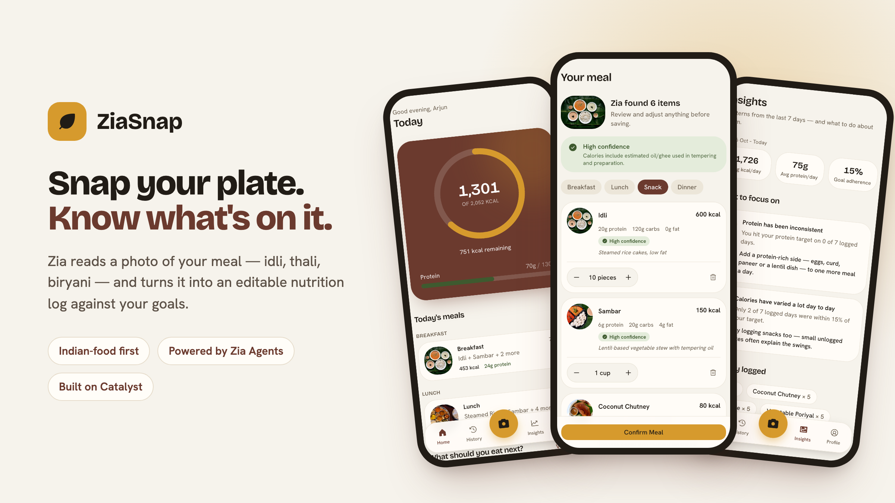

# ZiaSnap — project documentation



**Snap your plate. Know what's on it.** ZiaSnap turns a photo of a meal into an editable nutrition log and tracks it against your calorie and protein goals. It's built around Indian and South Indian food (idli, dosa, sambar, thali, biryani) rather than a generic Western calorie database.

- **Live app:** https://ziasnap-app-zfxbofjv.onslate.com (Catalyst Development environment)
- **Demo, no login:** https://ziasnap-app-zfxbofjv.onslate.com/demo opens a sample account ("Arjun") with two weeks of meals. Snap analysis there is the real Zia Agent; saved meals go into shared sample data that resets.
- **Stack:** Next.js 15 + React 19 + TypeScript on Catalyst **Slate**; backend on Catalyst **Functions** (Advanced I/O) + **Data Store**; meal recognition by a **Zia Agent** (Zoho Agent Studio) through a Catalyst **Connection**; sign-in through Catalyst **Authentication**.

---

## 1. What it does

| Feature | What the user gets |
|---|---|
| **Snap a meal** | Take or upload a photo. Zia names each dish, estimates the portion ("10 pieces", "1 bowl"), and gives calories, protein, carbs, fat and fibre per item, with a confidence level. |
| **Review before saving** | Every estimate is editable: change portions with +/−, remove items, add missed ones. Nothing is logged until the user confirms. |
| **Try without an account** | Anyone can snap and see Zia's analysis without signing up. Saving needs an account; the reviewed meal is kept in the browser and saved right after sign-up. |
| **Today** | A calorie ring and a protein bar against personal targets, plus the day's meals grouped by breakfast, lunch, snack and dinner. |
| **Personal targets** | Onboarding collects age, height, weight, goal (lose, maintain, gain), activity level and diet (vegetarian, eggitarian, non-vegetarian). Targets use a Mifflin–St Jeor estimate. |
| **What to eat next** | Meal suggestions that fit the calories and protein left today, filtered by diet and cuisine preference. |
| **Insights** | 7-day patterns: average calories and protein, consistency, most frequent foods, and one concrete thing to change. Shown once there are 3 days of data. |
| **History** | Day and week views of everything logged. |
| **Honest labels** | Every item shows whether it's an **AI estimate** (Zia's guess, reviewed but unchanged) or **edited / added by you**. Exports carry the same label. |
| **Smart confirmation** | When Zia is unsure about something that moves the calories (2 or 3 idlis? plain or ghee roast?), it asks up to two one-tap questions, each answer carrying Zia's own recalculated values. |
| **Personal food memory** | When you correct what a dish is (not just how many), ZiaSnap remembers it and applies your version the next time Zia sees that dish, labelled "Remembered from your edit". |
| **Quick log** | Type or say a meal ("2 idli, sambar and coffee"), repeat yesterday's breakfast, or log a saved favourite in one tap, with Undo. |
| **Water and streaks** | A light water tracker (goal from your weight) and a gentle logging streak, with no guilt messaging. |
| **Weight trend** | Log your weight; a smoothed trend line and an estimated date for reaching your target at your current pace. |
| **Zia meal planner** | The ZiaSnap Coach agent plans your next meal from what's left today and what you actually eat. |
| **Eating-out mode** | Photograph a restaurant menu and Zia picks the dishes that fit your day, with ordering tips. |
| **Weekly coach recap** | Every Sunday a scheduled job has Zia write a short recap with one win and one concrete change. |
| **Indian-first modes** | Navratri, Ekadashi and Ramadan modes switch suggestions to vrat-friendly or suhoor/iftar food for the mode's usual length. |
| **Installable, works offline** | Add to home screen. Meals, water and weight logged offline are saved on the phone and sync when you reconnect. |
| **Privacy** | Export everything (JSON) or the meal log (CSV); delete the account permanently. Meal photos are sent to Zia for analysis and **never stored**. |

## 2. Architecture

```
Browser (Next.js on Slate, ziasnap.onslate.com)
  │  Catalyst Web SDK: hosted login, generateAuthToken()
  │
  │  HTTPS + Authorization: <user token>   (cross-domain, CORS-whitelisted)
  ▼
ziasnap-api  (Catalyst Advanced I/O function, Node 22, TypeScript bundled by esbuild)
  ├── requireAccount() ── Catalyst Authentication (user scope)
  ├── CatalystNutritionRepository ── Data Store (admin scope, every query filtered by UserId)
  └── Zia client ── Catalyst Connection "agents" ─┬─ Zia Agent "ZiaSnap Meal Analyzer" (vision, smart confirmation)
                                                  └─ Zia Agent "ZiaSnap Coach" (planner, menu picks, weekly recap)

ziasnap-weekly-coach  (Catalyst Job function, Sundays 18:00 IST via Job Scheduling)
  └── for each user who logged that week: Coach recap → CoachReports (+ email when a sender is configured)
```

**Zoho-hosted models only.** Both agents run on Zoho's own `zlabs-qwen35-122B` thinking model through the `zoho-llm` ZKS configuration; no third-party LLM vendor is used.

**Shared domain logic.** The frontend and the function share one `NutritionRepository` interface and the same pure modules (goal calculator, daily summaries, insights, recommendations). esbuild bundles that shared code into the function, so both sides compute targets and insights identically.

**Two modes, one client.** With `NEXT_PUBLIC_ZIASNAP_API_URL` unset, the app runs on an in-memory demo user through Next.js mock routes (for UI work and screenshots). With it set, the same calls go to `ziasnap-api` with the signed-in user's token.

**Asynchronous analysis.** A Zia vision run takes about 20–25 s, and a Catalyst Advanced I/O request is cut off at 30 s. So `POST …/analyze` uploads the photo, starts the agent asynchronously (`X-ZIAAGENTS-ASYNC: true`) and returns within a few seconds; the browser then polls `GET …/analyze/<token>` every 2 s. The token is `<executionId>.<HMAC>`, binding the execution to its owner, so nobody can poll someone else's analysis by guessing IDs.

## 3. API reference — `ziasnap-api`

Base URL: `https://ziasnap-747318386.development.catalystserverless.com/server/ziasnap-api`

Every route except `/health` and `/guest/*` requires a signed-in Catalyst app user (`Authorization: <token from catalyst.auth.generateAuthToken()>`). Dates are the user's local calendar day, `YYYY-MM-DD`, and are always sent by the client, because the function runs in UTC.

| Method & path | Purpose | Notes |
|---|---|---|
| `GET /health` | Liveness | Public |
| `POST /guest/analyze` | Start analysis without an account | Public, 5 per 15 min per IP, nothing stored. Body `{ imageDataUrl }`. Returns 202 `{ analysisId, status: "analyzing" }` |
| `GET /guest/analyze/:token` | Poll guest analysis | `status: "analyzing"` until done, then the full result |
| `GET /me` | Signed-in account | `{ userId, email, firstName, lastName }` |
| `GET` / `PATCH /profile` | Read or update profile | First read creates a starter profile |
| `POST /onboarding` | Finish onboarding | Saves profile, recalculates targets, returns `{ profile, targets }` |
| `GET` / `POST /goals` | Read or recalculate targets | |
| `GET /today?date=` | Day summary | Totals, remaining, meals |
| `GET /history?start=&end=` | Day summaries for a range | Newest first, ≤ 366 days |
| `GET /insights?weekStart=` | 7-day insights | |
| `GET /recommendations?date=` | Next-meal suggestions | |
| `POST /meal/analyze` | Start analysis | Body `{ imageDataUrl, mealType? }` (base64, ≤ 10 MB). 202 + token |
| `GET /meal/analyze/:token` | Poll analysis | Result: `{ detectedItems: FoodItem[], overallConfidence, notes }` |
| `POST /meal/confirm` | Save a reviewed meal | Body: `type`, `source`, `items`, `notes?`, `analysisId?`, `loggedAt`, `dateKey` |
| `GET` / `PATCH` / `DELETE /meal/:id` | Read, edit or delete one meal | Owner-checked |
| `GET` / `POST /water`, `DELETE /water/:id` | Water for a day; add or undo a glass | |
| `GET` / `POST /weight`, `DELETE /weight/:id` | Weight trend and projection; log today's weight | One reading per day |
| `GET` / `POST /favorites`, `DELETE /favorites/:id` | Saved favourite meals | Up to 30 |
| `GET /streak?date=` | Logging streak | |
| `POST /coach/{plan,menu,weekly}` | Start a Coach task | Context is built server-side from the user's data; menu takes `imageDataUrl` |
| `GET /coach/{task}/:token` | Poll a Coach task | Weekly recaps are stored when done |
| `GET /coach/weekly/latest` | Latest stored recap | |
| `POST /guest/coach/{task}`, `GET /guest/coach/{task}/:token` | Coach for the public demo | Public, rate-limited, context sent by the browser, nothing stored |
| `GET /export` | Everything the user has stored | JSON; the app also renders a CSV |
| `DELETE /account` | Delete all data and the sign-in | Irreversible |

Errors are `{ "error": "message" }` with 400 (validation), 401 (not signed in), 404, 429 (guest limit, with `Retry-After`), 502 (Zia failed) or 500.

## 4. Data model (Catalyst Data Store)

All tables are GLOBAL scope and reached only through the function's admin scope. Every row carries `UserId`, and every query filters on it, so users are separated in code rather than by table permissions.

| Table | Key columns |
|---|---|
| `UserProfile` | `UserId` (unique), name, age, sex, height, weights, `Goal`, `ActivityLevel`, `PreferencesJson`, `TargetsJson`, `OnboardingCompletedAt` |
| `Meals` | `UserId`, `DateKey`, `MealType`, `Source`, `LoggedAt`, `ConfirmedAt`, `AnalysisId`, totals (`Calories`, `ProteinG`, `CarbsG`, `FatG`, `FiberG`) |
| `MealItems` | `UserId`, `MealId`, `Position`, `Name`, `Confidence`, `IsEdited`, `IsUserAdded`, `Calories`, `ItemJson` (the full FoodItem) |
| `FoodCorrections` | Personal food memory: latest correction per detected dish name |
| `WeightLogs` | One reading per day |
| `WaterLogs` | Each glass or bottle logged |
| `Favorites` | Saved meals for one-tap logging |
| `CoachReports` | One weekly recap per user per week |

## 5. Setup and deployment

**Prerequisites:** Node 22+, Catalyst CLI ≥ 1.27, access to the Catalyst project, and the Zia Agent plus a Catalyst Connection named `agents` (scopes `ZiaAgents.agents.TRIGGER` / `ALL` and files).

```bash
npm install
cd functions/ziasnap-api && npm install && cd ../..

# UI work on demo data (no sign-in):
npm run dev

# Backend secret (gitignored), then bundle the function:
cp functions/ziasnap-api/.env.example functions/ziasnap-api/.env.local   # set ANALYSIS_TOKEN_SECRET (openssl rand -hex 32)
npm run build:api

# Deploy: function first, then the frontend (which builds in real mode from .env.production)
catalyst deploy --only functions:ziasnap-api -ni
catalyst deploy slate ziasnap -ni
```

Sign-in only works locally under `catalyst serve`; the plain Next.js dev server lacks Catalyst's `/__catalyst/sdk/init.js` and session.

**One-time Catalyst console setup:** hosted authentication and public sign-up are on; `ziasnap.onslate.com` is in Authentication → Authorized Domains with CORS; `/app` redirects to `/` (the Web SDK still sends users to the legacy `/app/` path after login).

## 6. Privacy and safety

- Photos are forwarded to the Zia Agent for analysis and never written to storage.
- Estimates are labelled as AI estimates until the user edits them, and the app tells users to review every estimate. Health context is used as dietary context only, never as a diagnosis.
- Users can export everything they've stored and delete the account, which removes all rows and the sign-in.
- The guest analyzer is rate-limited because it spends Zia credits without a login.

## 7. Known limits and what's next

- Photo analysis takes about 25 to 30 s end to end and Coach answers 13 to 20 s, almost all of it the Zoho model; the app starts work in the background and polls, so no request hits the 30 s function limit.
- Weekly recap emails need a verified Catalyst sender (`RECAP_FROM_EMAIL`); until one is configured, recaps appear in the app only.
- Only email sign-in is enabled today; adding Zoho as a sign-in provider is pending.
- Runs in the Catalyst Development environment; Production promotion is pending.
- Fasting modes change suggestions but deliberately not calorie targets, and remind users to check with a doctor if they have a medical condition.
